# Motion FX Lab

**Code-made motion graphics → MP4 with sound.** Write the animation as a web page, yourself or with an AI coding assistant, and this repository renders it frame by frame to a checked MP4 with sound. Licence: [0BSD](LICENSE), no conditions.

[](media/intro.mp4?v=intro-2)

▶ **[Intro video, with sound](media/intro.mp4?v=intro-2)** · **[Live gallery](https://howardc38.github.io/motion-fx-lab/)** · No build step · Editable motion and sound

GitHub does not play repository videos inline, so the loop above is a short GIF (the only GIF in the repository); the film cards below are posters. The live gallery plays silent loops on its cards, the real videos with sound and every effect.

## What it is for

This repo has two jobs. It shows which effects exist, what videos they can make and which use cases they suit. It also gives you the means to write the animation as web code and render it, frame by frame, to an MP4 with sound. Production work (briefs, prompts, client material) stays outside it.

Describe the video to an AI coding assistant, or write it yourself. It becomes a web page: motion, music and sound effects are made in code, and the text, data and timeline stay editable. Original image assets can be supplied separately. The dialogue films add generated speech with analysed mouth cues.

## Quick start

```sh
git clone https://github.com/howardc38/motion-fx-lab.git
cd motion-fx-lab
npm install
npx playwright install chromium
npm run setup:hooks                     # once per clone: pushes only branches and tags, after npm run check:public
node video/serve.cjs 8000               # preview at http://127.0.0.1:8000/ (byte ranges, so MP4s play and seek)
bash video/build.sh examples/reel.html  # render an example, or a page of your own, into media/
```

Rendering needs macOS on Apple silicon for the GPU path, plus Node, Python 3 (standard library only) and ffmpeg with libx264. Tested with Node 26.8.1, Python 3.12.10, ffmpeg 8.1.1 and Playwright 1.59.1. Without a Metal GPU, render on SwiftShader with `RECORD_ARGS="--cpu --workers 2" bash video/build.sh examples/reel.html`. Films with WebGPU effects, such as `examples/stacks.html`, need a real WebGPU adapter and refuse `--cpu`.

Each film page has a scrub bar while you preview it; the recorder hides it. The build checks the video, audio, poster and preview in a staging folder before it replaces the matching files in `media/`; a failed check keeps the previous ones.

## Use cases and demo films

Each card is one editable page. Change the words, numbers or brand near the top of the file and render again; other ratios and brands come from the same page. The studio, shops and numbers are fictional sample data.

<!-- films:cards:start -->
**Use cases**

<table>
<tr>
<td width="33%" valign="top"><a href="media/reel.mp4">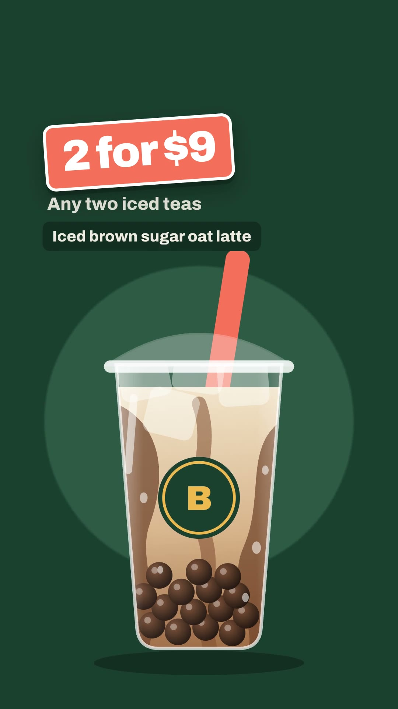</a><br><b>This weekend only</b> · 12 s · 9:16<br>One data file, three shop promos, safe for every app’s buttons.<br><sub><b>Use for:</b> Reels, Shorts and TikTok promos for a shop or venue.</sub><br><sub>Also rendered: <a href="media/reel-bakery.mp4">bakery, 9:16</a> · <a href="media/reel-yoga.mp4">yoga studio, 9:16</a></sub><br><a href="examples/reel.html">Source</a></td>
<td width="33%" valign="top"><a href="media/product.mp4">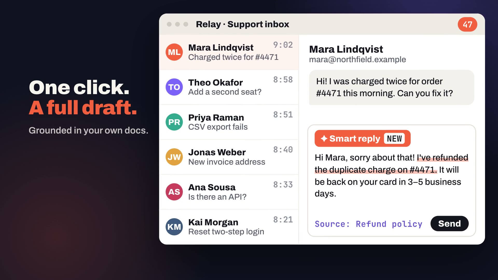</a><br><b>Feature launch in 15 seconds</b> · 15 s · 16:9<br>One new feature, from problem to result, in 15 seconds.<br><sub><b>Use for:</b> Feature launches, release notes and app-store previews.</sub><br><sub>Also rendered: <a href="media/product-square.mp4">1:1</a></sub><br><a href="examples/product.html">Source</a></td>
<td width="33%" valign="top"><a href="media/infographic.mp4">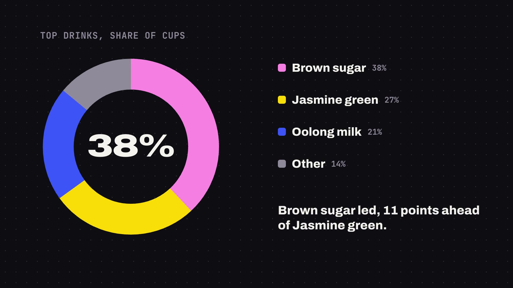</a><br><b>Year in numbers</b> · 14.4 s · 16:9<br>Your figures, each page ending on its point.<br><sub><b>Use for:</b> Annual reviews, reports and data explainers.</sub><br><sub>Also rendered: <a href="media/infographic-vertical.mp4">9:16</a></sub><br><a href="examples/infographic.html">Source</a></td>
</tr>
<tr>
<td width="33%" valign="top"><a href="media/broll.mp4">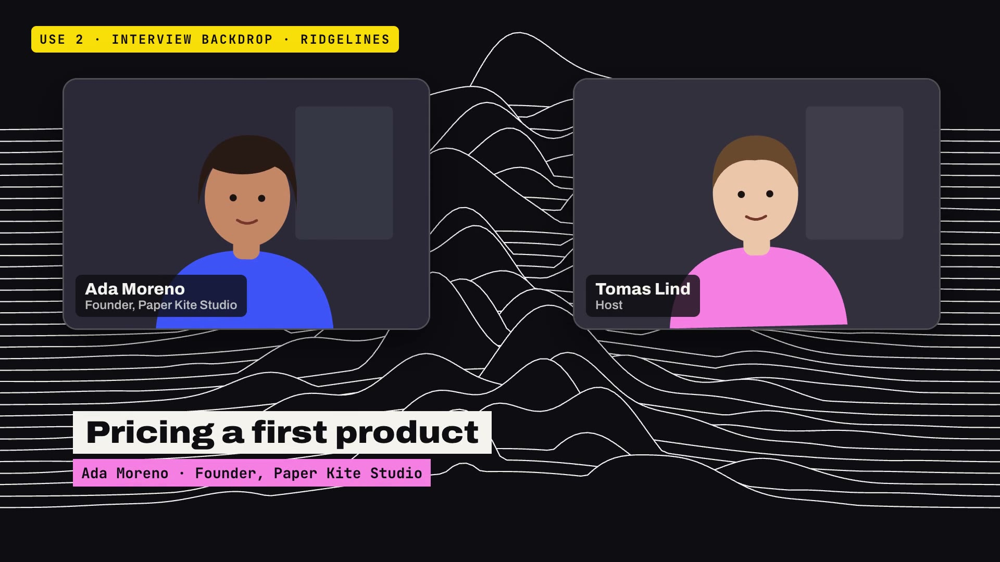</a><br><b>Background loops in place</b> · 12 s · 16:9<br>Seamless loops behind a title, an interview and a “starting soon” screen.<br><sub><b>Use for:</b> Title backgrounds, interview backdrops and stream holding screens.</sub><br><a href="examples/broll.html">Source</a></td>
<td width="33%" valign="top"><a href="media/titles.mp4">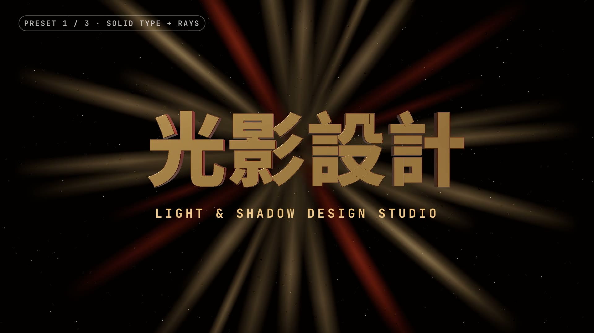</a><br><b>Titles &amp; logo stings</b> · 18 s · 16:9<br>Type a name, pick a preset, render a 6-second opener.<br><sub><b>Use for:</b> Channel intros, podcast openers and logo stings.</sub><br><sub>Also rendered: <a href="media/titles-vertical.mp4">9:16</a></sub><br><a href="examples/titles.html">Source</a></td>
<td width="33%" valign="top"><a href="media/countdown.mp4">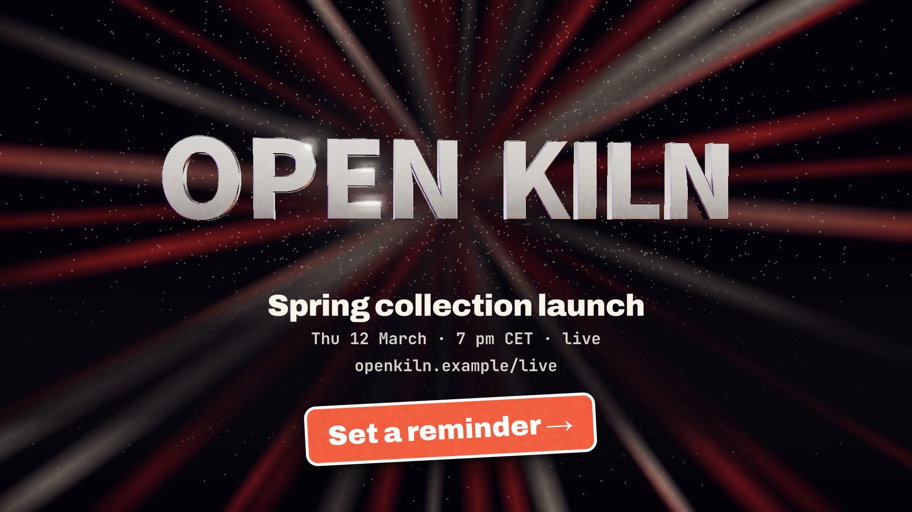</a><br><b>Event countdown</b> · 15 s · 16:9<br>Change the name and details, get a beat-locked countdown and logo reveal.<br><sub><b>Use for:</b> Launch, livestream and event countdowns.</sub><br><sub>Also rendered: <a href="media/countdown-vertical.mp4">9:16</a></sub><br><a href="examples/countdown.html">Source</a></td>
</tr>
<tr>
<td width="33%" valign="top"><a href="media/spotlight.mp4">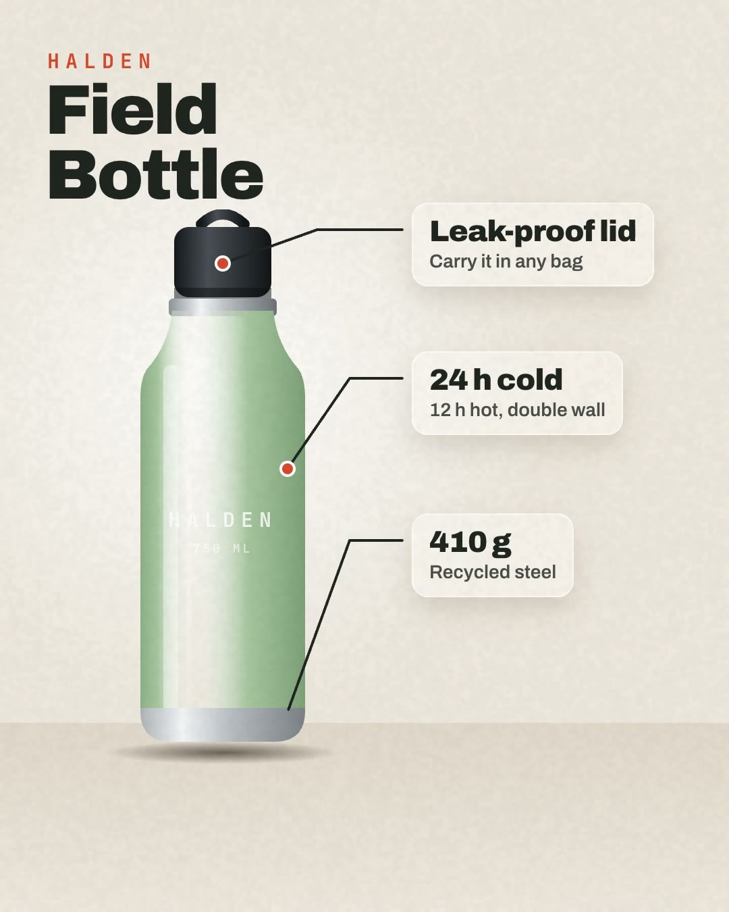</a><br><b>Product spotlight</b> · 10 s · 4:5<br>One product, three ratios: drop, callouts, colourways, price.<br><sub><b>Use for:</b> Shop listings, product ads and social posts.</sub><br><sub>Also rendered: <a href="media/spotlight-vertical.mp4">9:16</a> · <a href="media/spotlight-square.mp4">1:1</a></sub><br><a href="examples/spotlight.html">Source</a></td>
</tr>
</table>

**Demo films**

<table>
<tr>
<td width="33%" valign="top"><a href="media/character-dialogue.mp4">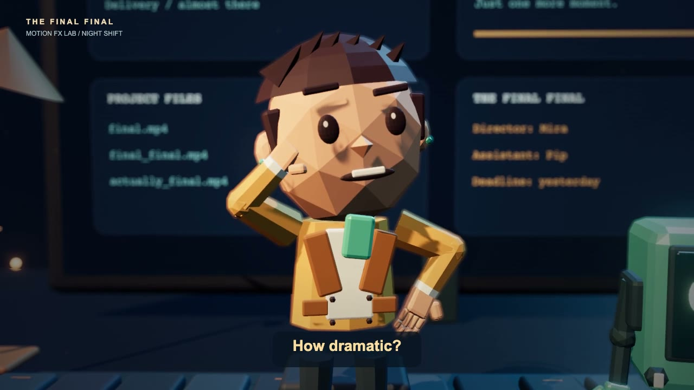</a><br><b>The Final Final</b> · 23.8 s · 16:9<br>The bear asks for the launch video. Pip has made one small, dramatic improvement.<br><sub><b>Use for:</b> Voiced character stories, product explainers and comedy shorts.</sub><br><a href="examples/character-dialogue.html">Source</a> · <a href="fx/dialogue/README.md">edit guide</a></td>
<td width="33%" valign="top"><a href="media/style-journey.mp4">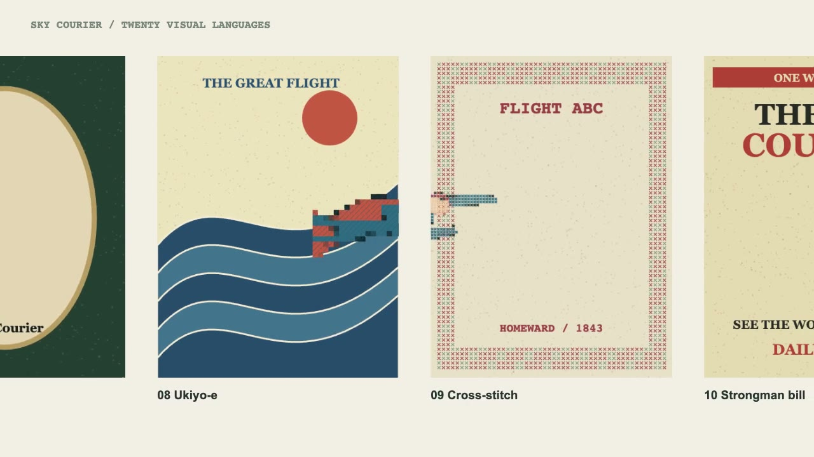</a><br><b>One flight. Twenty worlds.</b> · 40.8 s · 16:9<br>One courier travels through twenty artworks while its flight and cape remain continuous.<br><sub><b>Use for:</b> Character-led journeys and transitions between visual worlds.</sub><br><a href="examples/style-journey.html">Source</a></td>
<td width="33%" valign="top"><a href="media/water-forms.mp4">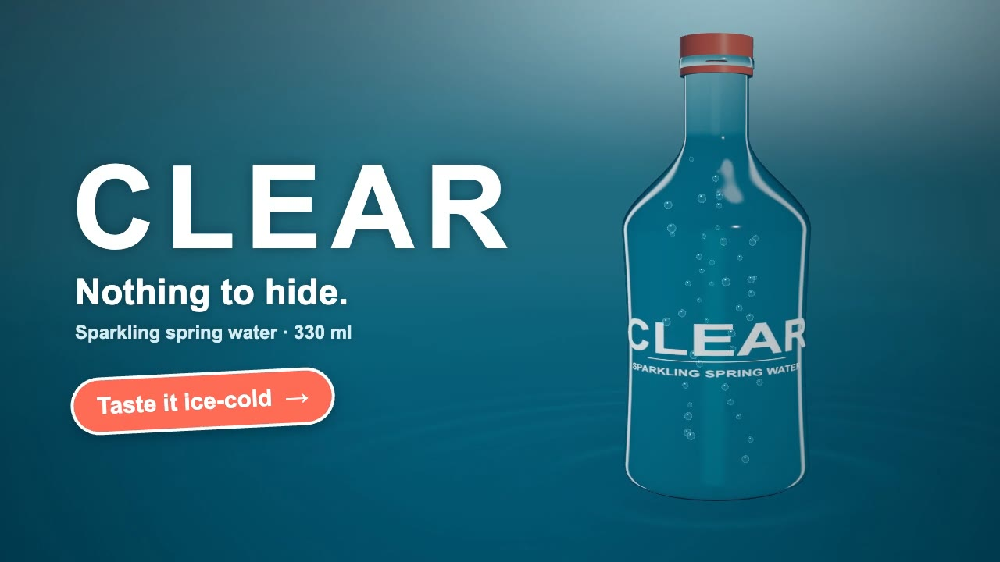</a><br><b>Clear</b> · 15 s · 16:9<br>A drop becomes a crown splash, rises into a bottle that refracts the brand, dives underwater and surfaces on the end card.<br><sub><b>Use for:</b> Product adverts and material-led openers.</sub><br><sub>Also rendered: <a href="media/water-forms-vertical.mp4">9:16</a></sub><br><a href="examples/water-forms.html">Source</a> · <a href="fx/material-studies/README.md">edit guide</a></td>
</tr>
<tr>
<td width="33%" valign="top"><a href="media/dot-story.mp4">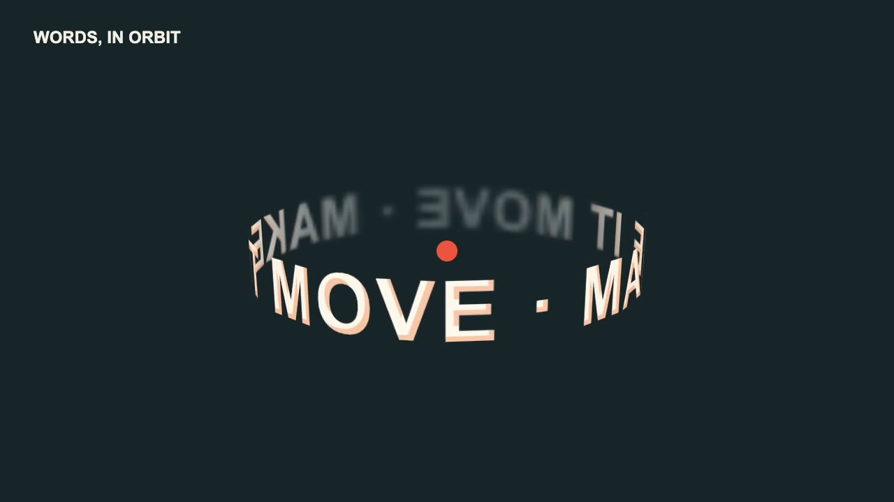</a><br><b>One dot. Many roles.</b> · 14.1 s · 16:9<br>A visual cue connects type, timing, depth and a reveal; closes its loop.<br><sub><b>Use for:</b> Brand loops, logo openers and identity motion.</sub><br><a href="examples/dot-story.html">Source</a> · <a href="fx/design/README.md">edit guide</a></td>
<td width="33%" valign="top"><a href="media/dot-battle.mp4">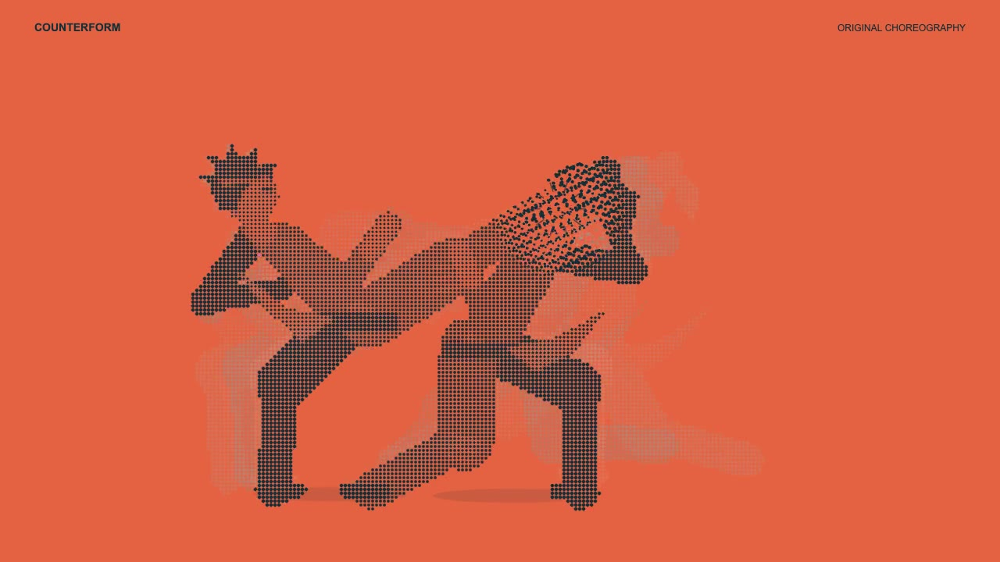</a><br><b>COUNTERFORM</b> · 19.8 s · 16:9<br>Original action choreography and contact holds; at the climax time stops and the camera circles the fighters as a 3D point cloud.<br><sub><b>Use for:</b> Action promos, game trailers and sports intros.</sub><br><a href="examples/dot-battle.html">Source</a></td>
</tr>
</table>
<!-- films:cards:end -->

Comparisons (one input, different treatments) and effect films (the full render of one effect) are listed with everything else under [All published films](#all-published-films).

## Effects

Each effect is a small function of time that draws one look or motion: materials and light, simulations, characters, type and time controls. The [live gallery](https://howardc38.github.io/motion-fx-lab/#effects) plays them all in the browser, keeps variants inside one card, and shows the Motion basics (the everyday moves the use cases are built from) in a section of their own. See [how effects are grouped](fx/VIEWING-GUIDE.md).

<!-- fx:effects:start -->
| Kind | Effects, in gallery order |
|---|---|
| Materials & surfaces | [Holographic foil](https://howardc38.github.io/motion-fx-lab/#demo-optical-foil) · [Plush fur](https://howardc38.github.io/motion-fx-lab/#demo-plush-fur) · [Burn dissolve](https://howardc38.github.io/motion-fx-lab/#demo-dissolve) · [Chrome monogram](https://howardc38.github.io/motion-fx-lab/#demo-chrome) · [3D shape blending](https://howardc38.github.io/motion-fx-lab/#demo-clay) · [Water and glass](https://howardc38.github.io/motion-fx-lab/#demo-water-material) · [Light-responsive surface hatching](https://howardc38.github.io/motion-fx-lab/#demo-design-surface-ink) |
| Light & image treatments | [Light through a stencil](https://howardc38.github.io/motion-fx-lab/#demo-rays) · [Image and footage halftone dots](https://howardc38.github.io/motion-fx-lab/#demo-studio-video-dots) · [Image relief](https://howardc38.github.io/motion-fx-lab/#demo-studio-depth-dots) · [Moiré interference](https://howardc38.github.io/motion-fx-lab/#demo-optical-moire) · [Caustic light](https://howardc38.github.io/motion-fx-lab/#demo-optical-caustic) · [Image displacement](https://howardc38.github.io/motion-fx-lab/#demo-liquid) |
| 3D space & particles | [Infinite grid by domain repetition](https://howardc38.github.io/motion-fx-lab/#demo-domainrep) · [Low-poly flight course](https://howardc38.github.io/motion-fx-lab/#demo-studio-lowpoly) · [Particle flow into type](https://howardc38.github.io/motion-fx-lab/#demo-gpuparticles) · [Skinned point cloud](https://howardc38.github.io/motion-fx-lab/#demo-studio-skin-cloud) · [Orbital particles](https://howardc38.github.io/motion-fx-lab/#demo-stack-gpu) |
| Physics & growth | [Volumetric smoke around geometry](https://howardc38.github.io/motion-fx-lab/#demo-fluid-smoke) · [Reaction–diffusion growing from text](https://howardc38.github.io/motion-fx-lab/#demo-reaction) · [Fluid flow and overflow](https://howardc38.github.io/motion-fx-lab/#demo-fluid-overflow) · [Rigid bodies with Matter.js](https://howardc38.github.io/motion-fx-lab/#demo-rigid) |
| Characters | [Speech, expression and lip sync](https://howardc38.github.io/motion-fx-lab/#demo-dialogue-lipsync) · [Character shading](https://howardc38.github.io/motion-fx-lab/#demo-toon) · [Rigged 2D character](https://howardc38.github.io/motion-fx-lab/#demo-character-rig) |
| Motion & timing | [Freeze frame and camera orbit](https://howardc38.github.io/motion-fx-lab/#demo-studio-freeze-orbit) · [Time echoes and speed ramps](https://howardc38.github.io/motion-fx-lab/#demo-studio-echo) · [Motion shatter and reassemble](https://howardc38.github.io/motion-fx-lab/#demo-signal-motion-fragments) · [Cross-frame style portal](https://howardc38.github.io/motion-fx-lab/#demo-studio-portal) · [Shape morphing](https://howardc38.github.io/motion-fx-lab/#demo-optical-morph) · [Drop, crown and rebound](https://howardc38.github.io/motion-fx-lab/#demo-water-impact) · [Folding paper ribbon](https://howardc38.github.io/motion-fx-lab/#demo-optical-ribbon) |
| Backgrounds | [Organic closed contours](https://howardc38.github.io/motion-fx-lab/#demo-organic-contours) · [Bauhaus tile rhythm](https://howardc38.github.io/motion-fx-lab/#demo-rhythm) · [Noise ridgelines](https://howardc38.github.io/motion-fx-lab/#demo-ridgelines) |
| UI & data | [3D card flip grid](https://howardc38.github.io/motion-fx-lab/#demo-cardflip) |
| Type | [Type in three-dimensional space](https://howardc38.github.io/motion-fx-lab/#demo-design-type-orbit) · [Slit-scan typography](https://howardc38.github.io/motion-fx-lab/#demo-optical-slit) · [Solid lettering](https://howardc38.github.io/motion-fx-lab/#demo-cjk-solid) · [Variable-font kinetic type](https://howardc38.github.io/motion-fx-lab/#demo-vartype) · [Signal breakup](https://howardc38.github.io/motion-fx-lab/#demo-glitch) · [Whip-in letters + motion blur](https://howardc38.github.io/motion-fx-lab/#demo-whip) |
| Motion basics | [Camera move over real UI](https://howardc38.github.io/motion-fx-lab/#demo-uifly) · [3-second headline hook](https://howardc38.github.io/motion-fx-lab/#demo-hook) · [Staggered letter animation](https://howardc38.github.io/motion-fx-lab/#demo-chars) · [Word-synced captions](https://howardc38.github.io/motion-fx-lab/#demo-karaoke) · [Stroke reveal](https://howardc38.github.io/motion-fx-lab/#demo-datachart) · [Timing: squash and stretch with its graph](https://howardc38.github.io/motion-fx-lab/#demo-timing) · [Frosted glass card](https://howardc38.github.io/motion-fx-lab/#demo-glass) · [Light sweep](https://howardc38.github.io/motion-fx-lab/#demo-sweep) · [Red flash + shake + stamp](https://howardc38.github.io/motion-fx-lab/#demo-stamp) · [Beat sync](https://howardc38.github.io/motion-fx-lab/#demo-beat) · [Sticker labels](https://howardc38.github.io/motion-fx-lab/#demo-sticker) · [Soft colour fields](https://howardc38.github.io/motion-fx-lab/#demo-gradient) · [Countdown ring](https://howardc38.github.io/motion-fx-lab/#demo-ring) · [Counting number](https://howardc38.github.io/motion-fx-lab/#demo-count) · [Typewriter](https://howardc38.github.io/motion-fx-lab/#demo-type) · [Highlighter](https://howardc38.github.io/motion-fx-lab/#demo-mark) · [Scan and check](https://howardc38.github.io/motion-fx-lab/#demo-scan) · [0.5 s wipe](https://howardc38.github.io/motion-fx-lab/#demo-wipe) · [Cool vs warm colour grade](https://howardc38.github.io/motion-fx-lab/#demo-lut) · [Source size and soft shadows](https://howardc38.github.io/motion-fx-lab/#demo-design-soft-shadow) · [Film grain](https://howardc38.github.io/motion-fx-lab/#demo-grain) |

Code families with their own guide: [stacks](examples/stack-lab/README.md) · [studio](assets/studio/README.md) · [materials](fx/material-studies/README.md) · [fluid](tools/blender/README.md) · [design](fx/design/README.md) · [signals](fx/signals/README.md) · [character](fx/character/README.md) · [dialogue](fx/dialogue/README.md) · [plush](fx/plush/README.md).
<!-- fx:effects:end -->

## Make your own video

Copy a page from `examples/` or `video/intro.html` and change it. The timeline engine needs:

- `#frame > #stage` with `data-w`, `data-h` and `data-dur` (width, height, seconds).
- `section.scene` children with `data-start` in seconds. A scene wipes in over 0.5 s unless it has `data-trans="cut"`; an optional `.edge` child draws the wipe's edge.
- Elements animated by `data-fx` plus `data-at` (seconds after the scene starts). The names and their extra attributes are listed at the top of `video/engine.js`; an unknown name is an error. An element that holds a canvas, a video, a frame (iframe) or a gallery tile is never scaled: its scaling effects slide and fade instead, so parallel renders agree.
- `data-sfx` for a sound cue, using a name from `LEVEL` in `video/sfx.py`.
- `window.__music = [[seconds, section], …]`, with sections `intro`, `build`, `drop`, `lift`, `break`, `final` and `tail`. Put the drop on a 2.4 s bar line.
- Optionally `window.__poster = seconds` for the poster frame (a third of the way in by default); the poster is that exact frame. A film with a card on the website also declares `window.__preview = [[start, end], …]`, the shots of its silent card loop (cut to fit 800 × 450, at most 2 MB). Only the intro declares `window.__gif`, for the README hero (at most 3 MB).
- Optional `window.__audio = {src, sha256}` selects a repository-local score instead of generated music and effects. Its hash and duration are checked before delivery.
- `frame(t)` and `window.__renderHooks` may return promises; the recorder and the engine await them before reading pixels.
- Gallery effects run inside a scene with `<div class="stage" data-demo="<id>" data-t0="…">`, and another timeline page plays inside a frame (`<iframe data-src="…" width height>` at its own size, drawn at an exact time each frame and loaded only while its scene plays); see the script at the bottom of `video/intro.html`. For native-resolution shader footage, set `window.FX_RENDER_SIZE = {w: 1920, h: 1080}` before loading `fx/demos.js`.

Then run `bash video/build.sh video/yours.html`. To keep your films in a folder of their own while using this library, or to add one to the published list, see [video/PROJECTS.md](video/PROJECTS.md).

### How it works

A timeline effect never keeps state between frames that `t` does not decide. It reads `t` and sets what it draws:

```js
demo({ id: "count", kind: "type", period: 3.2, hero: 2.4, /* name, stacks, chips, purpose… */
  build(stage) {
    stage.innerHTML = `<div class="cnt-n">HK$<span>0</span></div>`;
    const n = stage.querySelector("span");
    return (t) => { n.textContent = Math.round(12000 * outCubic(lin(0.3, 1.6, t))).toLocaleString("en-US"); };
  } });
```

No `requestAnimationFrame` state, no clock, no unseeded randomness at draw time. Simulations follow the same rule: frame `t` shows the state after exactly `round(t × steps per second)` fixed steps from a fixed start, and asking for an earlier `t` starts again from step 0. That is what lets you scrub to any moment, render a frame again and get the same pixels, and split a video across browsers. Blender fluids instead select a frame from a finished offline bake; Blender is only needed to change the simulation.

```
page.html ─ record.cjs cues ─► cues.json ─► sfx.py + music.py ─► mix.wav ──────────┐
          └ record.cjs video ─► lossless BT.709 master (rendered twice, compared) ──┴─► deliver.py ─► .mp4 · _hq.mp4 · .jpg ─► preview.py ─► .preview.mp4 (and gif.py ─► .gif)
```

`video/build.sh` runs all of it.

## All published films

`examples/films.json` is the only source for this table, the site's film cards and lists, and `fx/films-data.js`; run `npm run sync:films` after editing it. Effect films also play inside their effect cards on the site.

<!-- films:start -->
32 published films: 1 intro, 15 use cases, 6 demo films, 1 comparison and 9 effect films. Effect films also play inside their effect cards.

| Layer | Film | Authored length | Format | Preview | Source |
|---|---|---:|---|---|---|
| Intro | [Intro](media/intro.mp4?v=intro-2) | 55.2 s | 16:9 | [loop](media/intro.preview.mp4) · [GIF](media/intro.gif?v=intro-2) · [poster](media/intro.jpg?v=intro-2) | [HTML](video/intro.html) |
| Use case | [This weekend only](media/reel.mp4) | 12 s | 9:16 | [loop](media/reel.preview.mp4) · [poster](media/reel.jpg) | [HTML](examples/reel.html) |
| Use case | [This weekend only (bakery)](media/reel-bakery.mp4) | 12 s | 9:16 | [poster](media/reel-bakery.jpg) | [HTML](examples/reel-bakery.html) |
| Use case | [This weekend only (yoga studio)](media/reel-yoga.mp4) | 12 s | 9:16 | [poster](media/reel-yoga.jpg) | [HTML](examples/reel-yoga.html) |
| Use case | [Feature launch in 15 seconds](media/product.mp4) | 15 s | 16:9 | [loop](media/product.preview.mp4) · [poster](media/product.jpg) | [HTML](examples/product.html) |
| Use case | [Feature launch in 15 seconds (square)](media/product-square.mp4) | 15 s | 1:1 | [poster](media/product-square.jpg) | [HTML](examples/product-square.html) |
| Use case | [Year in numbers](media/infographic.mp4) | 14.4 s | 16:9 | [loop](media/infographic.preview.mp4) · [poster](media/infographic.jpg) | [HTML](examples/infographic.html) |
| Use case | [Year in numbers (vertical)](media/infographic-vertical.mp4) | 14.4 s | 9:16 | [poster](media/infographic-vertical.jpg) | [HTML](examples/infographic-vertical.html) |
| Use case | [Background loops in place](media/broll.mp4) | 12 s | 16:9 | [loop](media/broll.preview.mp4) · [poster](media/broll.jpg) | [HTML](examples/broll.html) |
| Use case | [Titles & logo stings](media/titles.mp4) | 18 s | 16:9 | [loop](media/titles.preview.mp4) · [poster](media/titles.jpg) | [HTML](examples/titles.html) |
| Use case | [Titles & logo stings (vertical)](media/titles-vertical.mp4) | 18 s | 9:16 | [poster](media/titles-vertical.jpg) | [HTML](examples/titles-vertical.html) |
| Use case | [Event countdown](media/countdown.mp4) | 15 s | 16:9 | [loop](media/countdown.preview.mp4) · [poster](media/countdown.jpg) | [HTML](examples/countdown.html) |
| Use case | [Event countdown (vertical)](media/countdown-vertical.mp4) | 15 s | 9:16 | [poster](media/countdown-vertical.jpg) | [HTML](examples/countdown-vertical.html) |
| Use case | [Product spotlight](media/spotlight.mp4) | 10 s | 4:5 | [loop](media/spotlight.preview.mp4) · [poster](media/spotlight.jpg) | [HTML](examples/spotlight.html) |
| Use case | [Product spotlight (vertical)](media/spotlight-vertical.mp4) | 10 s | 9:16 | [poster](media/spotlight-vertical.jpg) | [HTML](examples/spotlight-vertical.html) |
| Use case | [Product spotlight (square)](media/spotlight-square.mp4) | 10 s | 1:1 | [poster](media/spotlight-square.jpg) | [HTML](examples/spotlight-square.html) |
| Demo film | [The Final Final](media/character-dialogue.mp4) | 23.8 s | 16:9 | [loop](media/character-dialogue.preview.mp4) · [poster](media/character-dialogue.jpg) | [HTML](examples/character-dialogue.html) |
| Demo film | [One flight. Twenty worlds.](media/style-journey.mp4) | 40.8 s | 16:9 | [loop](media/style-journey.preview.mp4) · [poster](media/style-journey.jpg) | [HTML](examples/style-journey.html) |
| Demo film | [Clear](media/water-forms.mp4) | 15 s | 16:9 | [loop](media/water-forms.preview.mp4) · [poster](media/water-forms.jpg) | [HTML](examples/water-forms.html) |
| Demo film | [Clear (9:16)](media/water-forms-vertical.mp4) | 15 s | 9:16 | [poster](media/water-forms-vertical.jpg) | [HTML](examples/water-forms-vertical.html) |
| Demo film | [One dot. Many roles.](media/dot-story.mp4) | 14.1 s | 16:9 | [loop](media/dot-story.preview.mp4) · [poster](media/dot-story.jpg) | [HTML](examples/dot-story.html) |
| Demo film | [COUNTERFORM](media/dot-battle.mp4) | 19.8 s | 16:9 | [loop](media/dot-battle.preview.mp4) · [poster](media/dot-battle.jpg) | [HTML](examples/dot-battle.html) |
| Comparison | [Same fight. Eight treatments.](media/fight-effects.mp4) | 38.4 s | 16:9 | [loop](media/fight-effects.preview.mp4) · [poster](media/fight-effects.jpg) | [HTML](examples/fight-effects.html) |
| Effect film | [Find the Form](media/fluid-smoke.mp4) | 9.6 s | 16:9 | [poster](media/fluid-smoke.jpg) | [HTML](examples/fluid-smoke.html) |
| Effect film | [Overflow](media/fluid-overflow.mp4?v=liquid-v2) | 9.6 s | 16:9 | [poster](media/fluid-overflow.jpg?v=liquid-v2) | [HTML](examples/fluid-overflow.html?v=liquid-v2) |
| Effect film | [Slow Gold](media/fluid-viscous.mp4?v=liquid-v2) | 9.6 s | 16:9 | [poster](media/fluid-viscous.jpg?v=liquid-v2) | [HTML](examples/fluid-viscous.html?v=liquid-v2) |
| Effect film | [One block. A drawn city.](media/ink-city.mp4) | 12 s | 16:9 | [poster](media/ink-city.jpg) | [HTML](examples/ink-city.html) |
| Effect film | [Optical effects](media/optical.mp4) | 31.6 s | 16:9 | [poster](media/optical.jpg) | [HTML](examples/optical.html) |
| Effect film | [Image distortion, collisions and particles](media/stacks.mp4) | 24 s | 16:9 | [poster](media/stacks.jpg) | [HTML](examples/stacks.html) |
| Effect film | [Pulse / Form](media/audio-relief.mp4) | 12 s | 16:9 | [poster](media/audio-relief.jpg) | [HTML](examples/audio-relief.html) |
| Effect film | [Motion / Release](media/motion-fragments.mp4) | 12 s | 16:9 | [poster](media/motion-fragments.jpg) | [HTML](examples/motion-fragments.html) |
| Effect film | [Say it. Mean it.](media/character-lipsync.mp4) | 11.6 s | 16:9 | [poster](media/character-lipsync.jpg) | [HTML](examples/character-lipsync.html) |
<!-- films:end -->

A loop (or the intro's GIF) is a silent selection of shots, not the full film. To cut the loops again from films already in `media/`, without rendering, run `node tools/make-previews.cjs` (add `--posters` to take each poster again). MP4 container durations can be about 0.1 s longer than the authored timeline because of the final frame and encoding timestamps.

```sh
npm run build:all                 # every published film
node tools/films.cjs build <id>   # one film, or a build group such as uses, studio or dialogue
npm run test:media                # each bundle against its page: size, length, poster, loop and size budgets
npm run check:films               # films.json against the schema, the catalogue and the source code
```

An appearance change to a shared renderer means rebuilding the films that use it; the intro embeds gallery effects, and the fight comparison uses the shared studio effects. Review the moving pictures as well as the tests: matching metadata or pixels do not prove a well-directed effect.

## Intro storyboard

| Time | Story |
|---|---|
| 0–2.4 s | Motion graphics in plain HTML, made by you or your AI coding assistant |
| 2.4–16.8 s | Six use cases, 2.4 s each, each played from its own published page: shop promo (9:16), feature launch, year in numbers, product spotlight (4:5), event countdown and B-roll loops |
| 16.8–21.6 s | A shot from The Final Final: the startled plush bear asks whether the launch video is ready and Pip answers "I made it more dramatic", with mouth cues, expressions and gestures in sync |
| 21.6–26.4 s | An effect montage, five shots: holographic foil, motion shatter, spatial type, audio relief and volumetric smoke |
| 26.4–33.6 s | One Flight, Twenty Worlds: six readable styles, then the twenty-style overview |
| 33.6–38.4 s | Titles & logo stings, played from its page: 光影設計 in solid type and rays, then 文字世界 in contours and a glitch |
| 38.4–43.2 s | One Push, Chain Reaction: follow the fall, then reveal all 48 dominoes |
| 43.2–50.4 s | The real line of `examples/titles.html` changes from SLOW SIGNAL to FLOW STATE, the same page rebuilds the new word, and `bash video/build.sh` reports 2 renders and 0 differing frames before the MP4 |
| 50.4–55.2 s | Repository and licence call to action |

Source: [intro.html](video/intro.html) and [intro-stories.js](fx/intro-stories.js). The use-case and titles shots are the published pages themselves, drawn at exact times, so the intro shows the current films after a rebuild; the stories combine existing effects and are not extra effects.

## Problems it handles

| Problem | What this repo does |
|---|---|
| Animation you cannot diff, review or batch | Every timeline effect is a small function of time in a plain web page; no framework or bundler. Render ten variants from a script. |
| Slow 3D in headless Chrome | Playwright's default headless Chromium runs WebGL on SwiftShader, a software GPU (99.8 ms a frame on our test scene). The recorder uses ANGLE Metal (4.0 ms), lossless CDP screenshots and 4 browsers in parallel. |
| Silent wrong frames | A lost WebGL context screenshots as a blank frame, and parallel browsers can disagree. The whole video is rendered twice, each frame on a different browser, and every frame is compared. |
| Colour shifts | ffmpeg's defaults use the BT.601 matrix with no colour tags, and browsers read untagged HD video as BT.709 (`#ff90e8` played as `#ff9fe8`). Screenshots are converted with BT.709 and every file is tagged; the checks refuse an untagged file. |
| Quiet or rejected uploads | Audio is limited, then brought to −14 LUFS by a linear gain, and its loudness and true peak are measured on the final file. AAC stays within 128 kbps for Reels. |
| CJK text | Solid lettering uses bundled CJK vector outlines; unsupported glyphs report how to rebuild the subset. |
| Licence worries | Code under 0BSD. Music and sound effects are synthesised in code; see [THIRD_PARTY.md](THIRD_PARTY.md) for fonts, textures and the optional voice tools. |

## It fails closed

Detected rendering discrepancies or failed delivery checks stop publication and keep the previous files. These checks establish repeatability and delivery limits; visual meaning, motion quality and physical plausibility still need review.

- WebGL must run on ANGLE Metal, or on SwiftShader when you pass `--cpu`; backends are never mixed in one run.
- Every WebGL context is checked on every frame. A page error, or a font still loading or failed, stops the run.
- Every frame is rendered twice, by two different browsers, and all frames are compared. A frame fails if more than 0.01 % of the samples in its luma or chroma planes differ by more than 8 levels, or more than 20 differ by more than 48. On a mismatch the recorder keeps the frames in `video/mismatch/` and `build.sh` renders again, up to 5 times.
- The audio must reach −14 LUFS by a linear gain after limiting. Each file is checked for codec, BT.709 tags, size, frame rate, peak bitrate, an AAC track within 128 kbps, `moov` ahead of `mdat` and no edit list.
- Two causes of disagreement found so far are handled in `video/engine.js`: SVG text laid out at a stale scale (it now uses `geometricPrecision`), and canvases rasterised at different scales while scaling in (elements that hold a canvas, video or tile now slide and fade instead).

## Benchmark

Measured on an Apple M4 laptop on 2026-09-28, on a 56-second, 1,693-frame test video with heavy 3D that is not included in this repository. These historical timings are not measurements of the current intro.

| | |
|---|---|
| Default headless Chromium (one browser, SwiftShader, `page.screenshot`) | 399.6 s |
| This recorder, 4 browsers, every frame rendered twice and compared | **52.9 s** (again: 51.5 s) |
| With an 8-frame spot check instead of full verification, 1 / 4 / 6 / 8 browsers | 71.0 / 26.4 / 28.5 / 31.9 s |
| Pixels identical between the fast CDP capture and `page.screenshot` | 8 of 8 test frames |

Beyond 4 browsers there is no gain, because a single ffmpeg process decodes every screenshot and writes the master. The live gallery's developer notes have the full table.

## Compared with other ways to make the same video

| | This repo | Remotion | HyperFrames | After Effects |
|---|---|---|---|---|
| You author | HTML, CSS, SVG, Canvas, three.js, GLSL | React components | HTML compositions | Timeline compositions, expressions and scripts |
| Licence | 0BSD | Free for eligible users; Company License otherwise | Apache-2.0 | Paid subscription |

References checked on 2026-10-03: [Remotion licence](https://github.com/remotion-dev/remotion/blob/main/packages/core/LICENSE.md), [HyperFrames](https://github.com/heygen-com/hyperframes) and [Adobe scripting documentation](https://helpx.adobe.com/after-effects/desktop/automate-in-after-effects/automate-animation/scripts.html).

## What is inside

| Path | What it is |
|---|---|
| `index.html`, `fx/gallery-page.js`, `fx/gallery-meta.js` | The site: use cases, demo films, the effect gallery, comparisons and Motion basics |
| `fx/manifest.json`, `tools/fx-manifest.cjs` | Which scripts register which effects, in load order, and the gallery order (`npm run sync:fx`) |
| `fx/catalog.js` | Effects, variants, Motion basics and presets: which demo belongs to which card |
| `fx/demos.js`, `fx/pack-*.js` | The core effects and the packs that register more with `FX.demo` |
| `fx/<family>/`, `fx/*-effects.js` | Larger effect families (studio, materials, fluid, design, signals, character, dialogue, plush, stacks), each with its guide |
| `examples/`, `examples/films.json` | Film pages and the published film list; `tools/films.cjs` validates it and writes the generated blocks |
| `video/engine.js` | Timeline engine: scenes, `data-fx` animations, wipes, sound cues and the preview scrub bar |
| `video/record.cjs`, `video/deliver.py`, `video/build.sh` | Render twice and compare, master the sound, deliver and check the files |
| `video/sfx.py`, `video/music.py` | Sound effects and music synthesised from oscillators and noise |
| `video/serve.cjs` | Loopback preview server with byte ranges, also used by the recorder |
| `assets/` | Original characters, footage, glyph outlines, bakes and textures, each folder with its manifest or guide |
| `tools/check-public.cjs`, `.githooks/pre-push` | The public-scope check and the hook that runs it before a push |

## Limits

- The GPU path is verified on macOS only. In our benchmarks, one of 8 parallel SwiftShader browsers lost its WebGL context and returned blank frames without an error, which is why the recorder checks every context on every frame.
- Emoji and a few symbols (✓, ★) are drawn with the operating system's fonts, so a render on Linux or Windows looks slightly different.
- The main gallery uses three.js r128; newer modules pin r180. Upgrading the gallery means re-tuning every colour, light and shader.
- Solid lettering uses a bundled subset of CJK outlines plus Latin capitals and digits; other characters require rebuilding that asset.
- The reaction–diffusion effect gives the same pixels every time on one GPU, but a different pattern on SwiftShader than on Metal. The recorder never mixes the two in one run.
- Browser tests cover effect contracts, gallery framing, film metadata, asynchronous recording and publication rollback. There is no CI yet; full video builds and visual review are done locally.

## "Seen in" credits

When a reel shows an effect this library did not have, it is rebuilt from scratch with original content, and the effect's card names the video under "Seen in". No code or artwork was taken from these videos.

| Video, on Threads | What was rebuilt |
|---|---|
| A TixFox promo by Berlin (@ox8erlin) | A character in flat colour and light, dithered to two inks with an ordered matrix (now the dither variant of Character shading) |
| Two motion-design reels by @designer.riven | Squash and stretch with its graph, variable-font type, polar morph, Bauhaus rhythm, ridgelines, card flip, data chart, ray-marched clay, domain repetition, five shader styles, GPU particles, reaction–diffusion and rigid bodies |

## Help wanted

- **Any render difference we have not met**: the frames in `video/mismatch/` show where two browsers disagreed.
- **A GPU path on Linux**, so renders can run on a server.
- **Broader recorder tests and CI**, especially failure paths and non-macOS GPU coverage.
- **More effects**, as long as each one stays a pure function of `t`.

If this saves you an export marathon or a night chasing blank frames, **star the repo**.

## Licence

[0BSD](LICENSE): use, copy, modify and distribute for any purpose, with or without attribution. The adapted TSL example, fonts, textures and voices keep their own notices; three.js, Matter.js, Flubber, PixiJS, Rapier and the web fonts load from public CDNs under their own licences. See [THIRD_PARTY.md](THIRD_PARTY.md).
